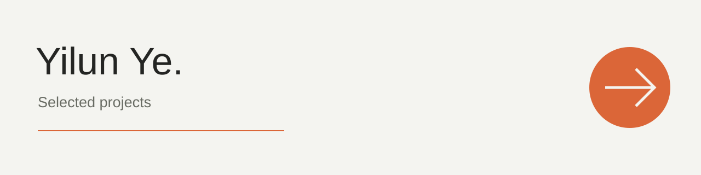

<p align="left"></p>

# 叶轶伦 · 作品集

我制作 AI 产品、创作工具和互动体验。这里收录四个由我独立负责构思、设计、实现与迭代的项目。

**Yilun Ye** · Independent products, creative tools & interactive experiences

## 项目

| 项目 | 做什么 | 展示入口 | 源码 |
|---|---|---|---|
| **RAFT Generator** | 图片、视频、数字人与素材协作工作台 | [项目介绍](projects/raft-generator/) · [在线产品](https://generator.raft.xin) | 私有 |
| **Company OS** | 人员与 Agent 的任务、权限、审批和结果追踪 | [项目介绍](projects/company-os/) · [GitHub](https://github.com/ElliottYip/company-os) | 已公开 |
| **Raft Notes** | 移动端记录、语音转写与 AI 整理 | [项目介绍](projects/raft-notes/) | 私有 |
| **金势牌馆** | 结合麻将元素的策略牌局与单人冒险 | [项目介绍](projects/jinshi-parlour/) | 私有 |

## 从哪里开始

- 想看 AI 创作产品：从 **RAFT Generator** 开始。
- 想看企业协作与系统设计：看 **Company OS**。
- 想看移动端信息记录：看 **Raft Notes**。
- 想看游戏与交互：看 **金势牌馆**。

每个项目页包含背景、个人工作、当前形态、预览和架构说明。项目中的开源依赖、字体与第三方组件遵循各自许可；“独立完成”指项目工作，并不表示所有底层依赖均为原创。

## 仓库结构

```text
selected-projects/
├── README.md                 # 对外展示入口
├── projects/
│   ├── raft-generator/       # 产品介绍 + 架构
│   ├── company-os/
│   ├── raft-notes/
│   └── jinshi-parlour/
├── assets/                   # 项目预览与封面
└── docs/
    └── repository-map.md     # 展示层与源码仓库关系
```

此仓库只收录公开展示材料。私有项目的源码、环境配置、运行数据和客户资料不包含在内。

[GitHub 主页](https://github.com/ElliottYip) · [邮件联系](mailto:yilun.ye@bath.edu)
