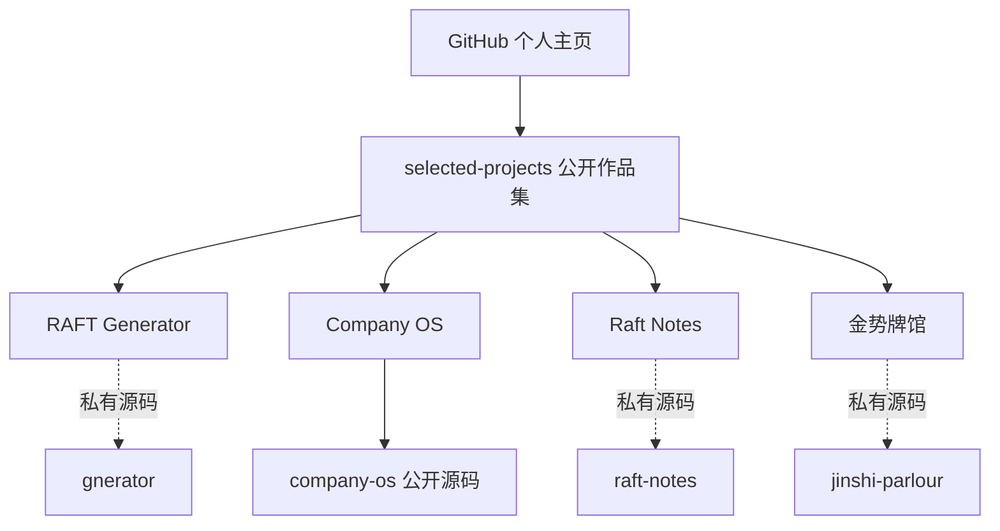

# 项目与仓库

采用“一个公开展示入口＋每个产品独立源码仓库”的结构。各产品可以独立开发、发布和控制访问权限。

| 仓库 | 定位 | 可见性 |
|---|---|---|
| `ElliottYip` | GitHub 个人主页与精选项目入口 | 公开 |
| `selected-projects` | 四个项目的介绍、预览与架构 | 公开 |
| `gnerator` | RAFT Generator 源码；保留既有仓库名，避免破坏关联 | 私有 |
| `company-os` | Company OS 源码与工程文档 | 保留既有公开状态 |
| `raft-notes` | 移动应用与服务端 AI 网关 | 私有 |
| `jinshi-parlour` | 游戏规则、客户端、单人冒险和联机服务 | 私有 |

私有仓库名仅用于说明组织方式；无权限的访客可直接阅读本作品集，不必申请源码访问。
