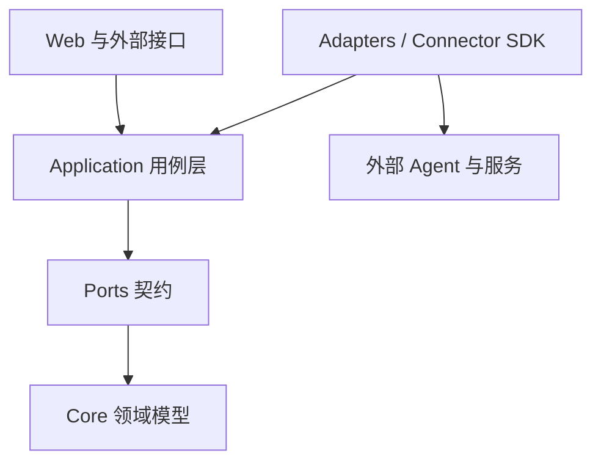

# Company OS · 架构

Company OS 是独立的人机协作控制层。人员与 Agent 通过任务、权限、审批、执行证据和责任记录协作；具体 Agent 由可替换连接器接入。

## 依赖方向

`core ← ports ← application ← adapters / web`

| 路径 | 职责 |
|---|---|
| `core/` | 领域模型与规则，不依赖供应商 SDK |
| `ports/` | 用例需要的外部能力契约 |
| `application/` | 任务与协作用例编排 |
| `adapters/`、`web/` | 外部接入与产品界面 |
| `connector-sdk/`、`connectors/` | Agent 执行接入 |
| `docs/` | 架构、接口、部署与成熟度说明 |

## 关键设计

任务执行与授权确认分开建模；外部系统通过契约接入。托管和自部署是同一代码库的部署形态。README 中的本地默认演示使用确定性 fixture，不能据此认定所有外部集成已在生产完成。

[公开架构文档](https://github.com/ElliottYip/company-os/blob/main/docs/architecture.md) · [返回项目](README.md)
