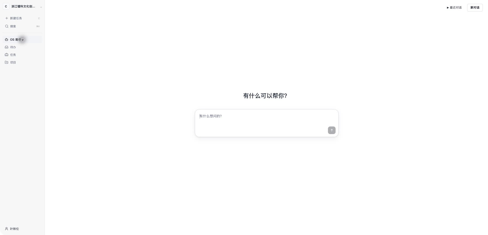

# Company OS

让人员与 AI Agent 围绕任务协作：谁来执行、哪些操作需要审批、结果如何验收，都有清楚的记录。

A control plane for teams working with AI agents, covering tasks, permissions, approvals and execution records.

[查看源码](https://github.com/ElliottYip/company-os) · [架构说明](ARCHITECTURE.md) · [工作区入口](https://anc.raft.xin/leike/)（需登录）

*当前线上工作区界面*

## 设计思路

企业使用 Agent 时，除了完成任务，还需要管理授权、协作和责任。我把这些需求放进统一的任务流程，让任务委派、执行状态与结果验收可以衔接起来。

## 我的工作

- 设计人员、Agent、任务和权限之间的关系，以及委派、审批和验收流程。
- 明确个人与共享工作区的信息范围、工具连接方式和人工确认节点。
- 将业务规则、应用流程与外部连接器分层，实现可替换的 Agent 接入方式。
- 配套整理 AgentBoss School，将任务委派、授权和验收方法转化为培训内容。

## 当前进展

源码已公开，线上工作区需登录访问。仓库中保留了架构、部署和成熟度文档，具体集成的完成情况以这些记录为准。

独立负责：产品设计、架构、实现与持续迭代。开源组件及依赖的许可保留在源码仓库中。

[返回作品集](../../README.md)
