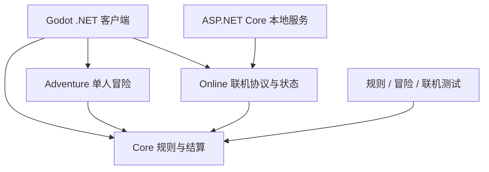

# 金势牌馆 · 架构

Godot .NET 客户端将牌桌反馈与像素美术呈现给玩家，C# 核心库承载规则，单人冒险与联机分别组织独立模块。

## 源码目录

| 路径 | 职责 |
|---|---|
| `game/Client/` | Godot 场景、C# 界面、图像与声音 |
| `game/Core/` | 牌型、牌局与结算规则 |
| `game/Adventure/` | 单人冒险与道具系统 |
| `game/Online/`、`game/Server/` | 联机状态与本地服务 |
| `game/*Tests/` | 可执行验证项目 |
| `docs/` | 设计决策与阶段验证 |
| `art/` | 美术来源与制作记录 |

## 当前边界

Godot 项目使用 `Godot.NET.Sdk/4.7.2`，C# 项目目标为 .NET 8。好友联机为本机多窗口验证；远程服务、Steam 接入、正式签名与发布不等同于已完成。

游戏美术与字体的来源记录随私有源码保留，第三方字体遵循自带许可。

[返回项目](README.md)
