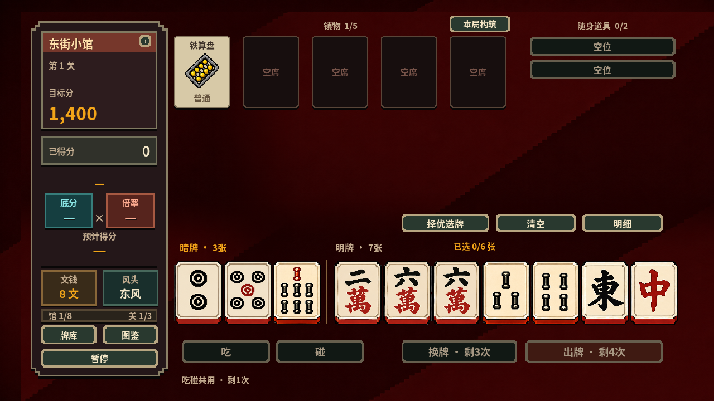

# 金势牌馆

麻将策略、单人冒险与像素美术

可试玩原型 · 源码私有

源码保持私有；此页提供玩法与架构介绍。

*项目试玩截图 · 2026.09*

## 项目概述

融合麻将元素的策略游戏实践，涵盖人机牌局、单人冒险与好友联机测试。

## 为什么做

复杂的规则、计分与道具组合，需要通过清楚的反馈和稳定的交互帮助玩家理解。

## 我的工作

叶轶伦独立负责产品构思、设计、实现与迭代。

- 围绕牌局规则、牌型计分与单人冒险组织玩法体验。
- 推进暗酒红像素美术、牌面识别、动作反馈与界面信息层级。
- 结合试玩与规则验证迭代流程，推进好友联机测试。

## 当前形态

形成可试玩版本，包含人机牌局、单人冒险和联机测试；目前作为独立互动产品实践展示。

人机牌局与单人冒险可本地运行；好友联机为本机多窗口验证，尚不代表远程服务或 Steam 已上线。

[架构与目录](ARCHITECTURE.md) · [返回项目总览](../../README.md)
