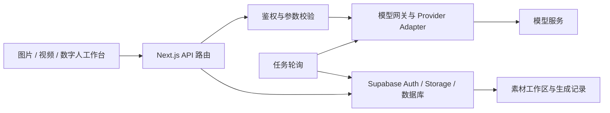

# RAFT Generator · 架构

以 Next.js 工作台组织创作入口，服务端负责鉴权、模型请求与生成任务持久化。

## 源码目录

| 路径 | 职责 |
|---|---|
| `src/app/` | 页面与服务端 API |
| `src/components/` | 创作、项目、数字人与工作区组件 |
| `src/lib/` | 数据访问、模型客户端、Provider 适配和环境工具 |
| `src/data/` | 静态内容与灵感条目 |
| `supabase/migrations/` | 数据库迁移 |
| `scripts/` | 检查与维护工具 |
| `public/` | 产品静态资源 |

## 设计关注

长任务需要清楚的提交、等待、失败和结果保存状态。模型参数与限制同时影响界面选项和服务端校验；素材管理承担结果复用，账号体系承接权限与用量。

此图概括仓库中已确认的模块关系，不包含生产密钥或内部基础设施信息。

[返回项目](README.md)
