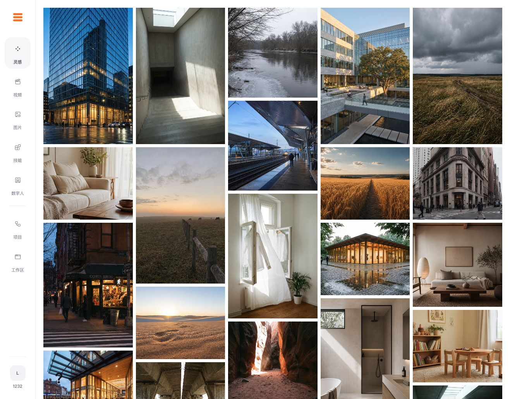

# RAFT Generator

把图片、视频、数字人创作与素材管理放进同一个工作台，为创意团队提供连贯的制作体验。

A creative workspace for AI-generated images, video and avatars, with tools to organize assets and manage projects.

[在线体验](https://generator.raft.xin) · [架构说明](ARCHITECTURE.md)

*线上产品界面*

## 设计思路

模型各有擅长，素材与生成结果也容易分散在不同工具中。我希望创作者可以在同一个地方完成素材输入、模型选择、生成和结果复用，让工作流围绕实际创作任务展开。

## 我的工作

- 设计从输入素材到保存结果的完整流程，包括模型选项、参数、任务状态和失败反馈。
- 对比模型的画面质量、人物一致性、生成时间与成本，调整适用场景和使用方式。
- 实现素材工作区、项目协作、用量统计与付费相关功能。
- 部署和维护服务器上的开源模型，配置多 GPU 推理环境与 ComfyUI 工作流。

## 当前进展

产品已上线，支持漫剧与 TikTok 团队的创作流程。源码保持私有。

独立负责：产品设计、实现与持续迭代。

[返回作品集](../../README.md)
