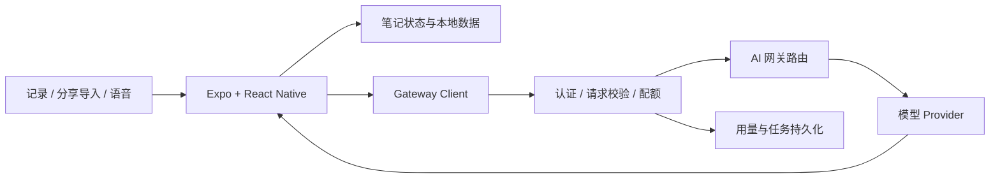

# Raft Notes · 架构

Expo + React Native 移动应用连接独立的服务端 AI 网关。客户端负责记录和交互，模型凭据保留在服务端。

## 源码目录

| 路径 | 职责 |
|---|---|
| `app/` | 移动端页面与路由 |
| `src/services/` | 输入处理、笔记管线、转写、整理和网关调用 |
| `src/store/`、`src/db/` | 状态与本地数据 |
| `server/` | AI 网关、认证、持久化与模型适配 |
| `ios/` | iOS 原生工程与分享扩展 |
| `__tests__/` | 应用侧测试 |
| `scripts/` | 发布前检查与工具 |

## 关键设计

信息采集与后续整理形成连续流程；网关统一处理模型调用、认证与用量。仓库保留应用源码与原生工程，运行数据库、签名材料、构建产物与本机备份不进入 GitHub。

[返回项目](README.md)
