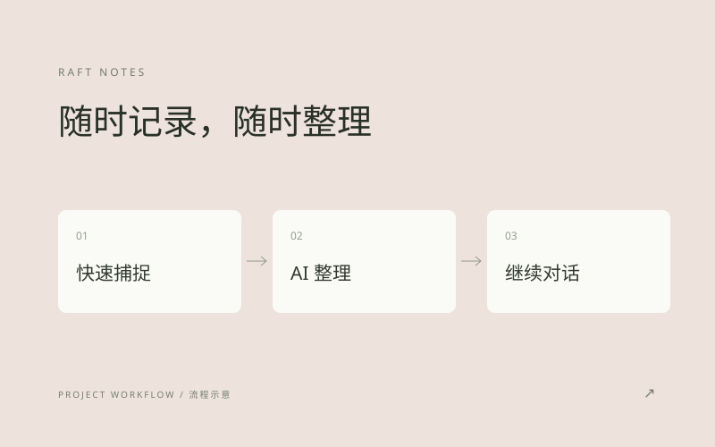

# Raft Notes

随时记下想法、保存零散信息，再用语音转写和 AI 整理，把它们变成可以继续使用的笔记。

An iOS-first notebook for capturing ideas, transcribing voice notes and organizing information with AI.

[架构说明](ARCHITECTURE.md)

*功能流程示意，非应用截图*

## 设计思路

记录应该轻松，整理也应该顺着记录发生。我把文字、语音和外部信息导入连接起来，让用户保存内容后，可以继续整理、查找或展开对话。

## 我的工作

- 设计并实现移动端记录、分享导入、语音转写与 AI 整理流程。
- 组织笔记状态、本地数据和后台处理，让采集与后续整理衔接起来。
- 搭建服务端 AI 网关，统一处理模型调用、认证与用量。
- 持续调整移动端交互和操作路径。

## 当前进展

已完成移动端笔记产品与配套网关，持续迭代使用体验。源码保持私有。

独立负责：产品设计、移动端与服务端实现、后续迭代。

[返回作品集](../../README.md)
